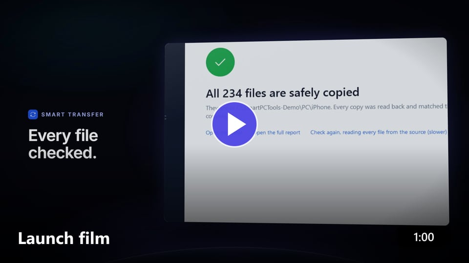
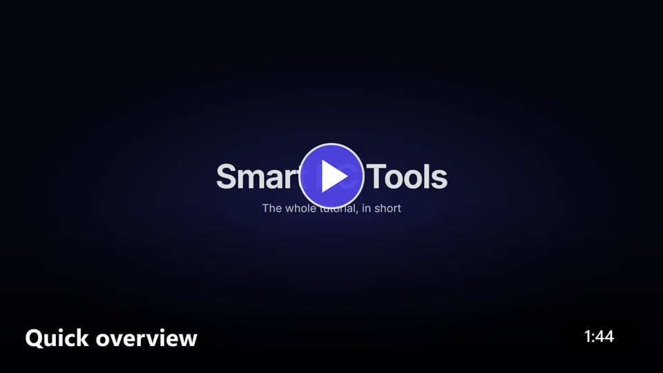
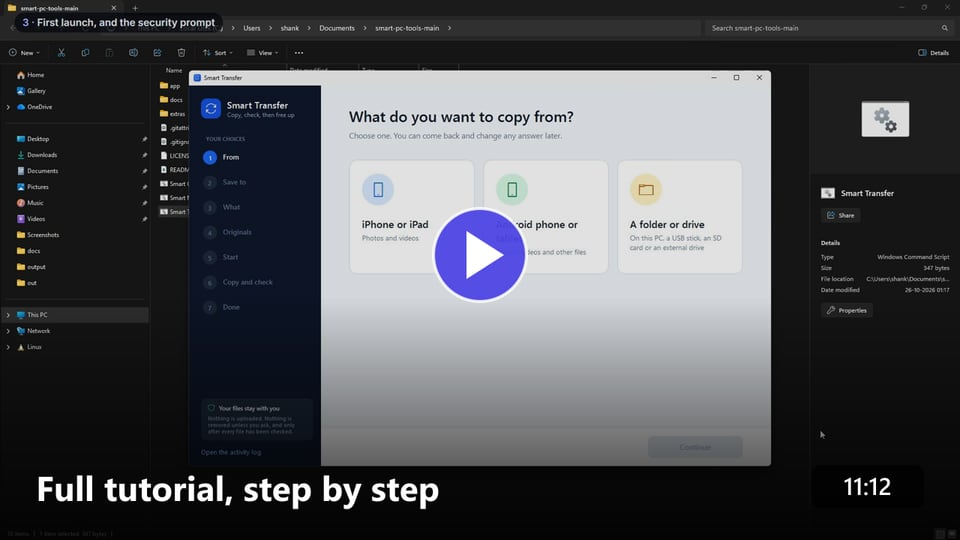

  
  
  
  

## What's inside

| | Tool | What it does |
| :---: | --- | --- |
| 📲 | **Smart Transfer** | Copies photos, videos and files from an **iPhone**, an **Android phone** or **any folder or drive** to your PC - and checks every file arrived perfectly. Pause any time, carry on later. |
| 🧹 | **Smart Cleanup** | Finds what fills up your PC - duplicates, junk, old downloads - and frees up space. Also tidies a messy folder. |
| ⚡ | **Smart Memory** | Makes a slow PC faster: closes apps you don't need and stops apps from starting by themselves. |

## Watch it

<table>
  <tr>
    <td align="center" width="33%">
       
      <b>Launch film</b> · 1 min 
      The three tools in a minute
    </td>
    <td align="center" width="33%">
       
      <b>Quick overview</b> · 1:44 
      Download, open, use
    </td>
    <td align="center" width="33%">
       
      <b>Full tutorial</b> · 11 min 
      Every step, from GitHub to done
    </td>
  </tr>
</table>

## Start in 3 steps

1. **Download** - click the button above (or the green **Code** button, then **Download ZIP**).
2. **Unzip** - right-click the downloaded file and choose **Extract All...**
3. **Double-click** `Smart Transfer.cmd`, `Smart Cleanup.cmd` or `Smart Memory.cmd`.

That's it. Nothing to install. Each tool asks you **one simple question per screen**, and **Back** always takes you back.

> [!TIP]
> Windows says *"Windows protected your PC"*? That only means the file came from the internet. Click **More info**, then **Run anyway**.

## Safe by design

- ✅ **Nothing happens until you say yes** - you always see what will change first.
- ✅ **Every copied file is checked** before anything is removed from your phone.
- ✅ **Deleted files go to the Recycle Bin**, so you can get them back.
- ✅ **Everything stays on your PC** - no uploads, no accounts, no ads.

## Need more help?

📖 The **[full guide](docs/GUIDE.md)** explains every screen, answers common problems (like *"my iPhone doesn't show up"*), and has the extras for advanced users.

Made by <a href="https://github.com/sashankbanda">Sashank Banda</a> · <a href="LICENSE">License</a>

