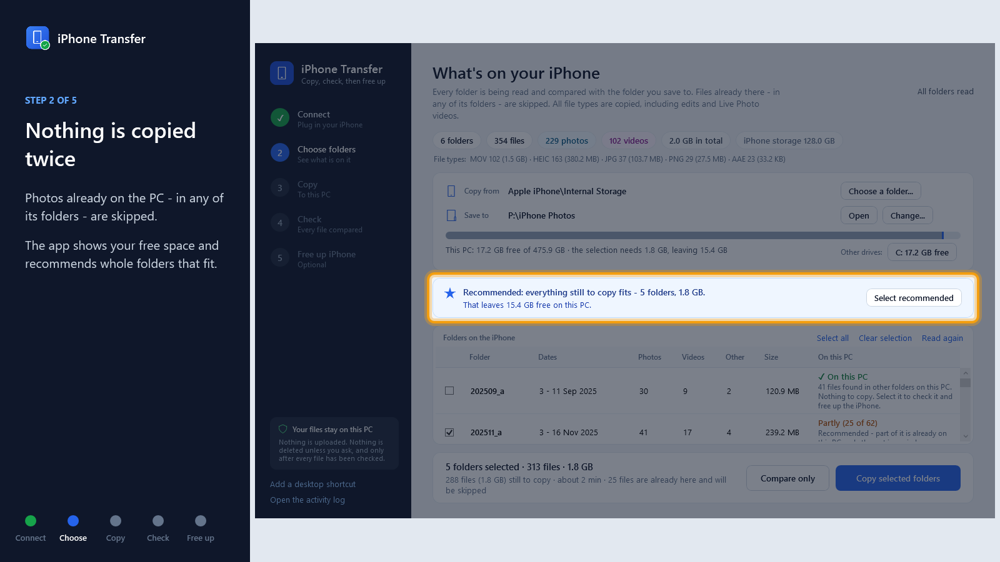

# iPhone Media Transfer

Copy the photos and videos off your iPhone onto your Windows PC, check that every single file arrived intact, and only then free up the space on the phone.

No iTunes sync, no cloud upload, no third-party service. Files are copied byte for byte: nothing is re-encoded, and the original capture dates are kept.

It comes in two forms:

- **The iPhone Transfer app** - a simple window that walks you through it. Made for everyone; no typing.
- **The `Copy-IPhoneMedia.ps1` script** - the same verified copy from the command line, for repeat or scheduled runs.

## Watch how it works (2 minutes)

[](docs/iPhone-Transfer-tutorial.mp4)

**[Watch the video](docs/iPhone-Transfer-tutorial.mp4)** - every step, on the real app: connect, choose folders, copy, check, and free up the iPhone. (On GitHub, open the file and press *View raw* to play or download it.)
## Before you start

**1. Install Apple Devices** from the Microsoft Store: **➡️ [Apple Devices](https://apps.microsoft.com/detail/9np83lwlpz9k?hl=en-US&gl=BG)**

Windows cannot see an iPhone on its own - plug one into a fresh Windows install and you get a charging cable and nothing else. Apple Devices adds the *Apple Mobile Device Support* drivers that make the iPhone and its photo folders appear under **This PC**. You do not have to open the app, create an account or sign in; installing it is enough. If you already have iTunes or Apple Devices, you are ready.

**2. Get this project.** On GitHub press **Code > Download ZIP** and unzip it anywhere (for example into *Documents*), or:

```bash
git clone https://github.com/sashankbanda/iphone-file-transfer.git
```

Windows 10 or 11 is all you need otherwise - PowerShell is built in.

**3. Plug in the iPhone, unlock it, and tap "Trust"** when it asks. A locked or untrusted phone shows up as empty.

## The app

**Double-click `iPhone Transfer.cmd`.** A window opens and walks you through five steps. In the app's sidebar, *Add a desktop shortcut* puts an icon on your desktop for next time.

### 1. Connect

The app watches for the iPhone and finds it by itself as soon as it is plugged in and unlocked. If it is plugged in but locked, it tells you to unlock it. If nothing shows up, *The iPhone does not show up?* lists the usual fixes.

Not an iPhone? *Use a folder on this PC instead* works with an SD card, a camera, or an old backup folder.

### 2. Choose folders

At the top you set the two places the app works with:

- **Copy from** - the iPhone, or *Choose a folder...* for any folder on the PC (an SD card, a camera, a backup). The folder may hold month folders, or the photos themselves.
- **Save to** - *Choose where to save...* picks your photo folder, for example `C:\06_IPHONE_PHOTOS`. Nothing is copied until you have chosen it; it is remembered for next time. Pick the main folder, not one of its month folders - the app keeps the source's folders inside it (and offers to fix it if you pick a month folder).

The iPhone keeps photos in one folder per month (`202608_a` is August 2026; a busy month gets `_b`, `_c`, ...). The app reads every folder and shows, per folder:

- the dates the photos were taken
- how many photos, videos and other files are in it, its size, and the file types (hover over a folder)
- whether it is already on this PC: *Not on this PC yet*, *Partly (1,200 of 2,159)*, or *On this PC*

**How "already on this PC" is decided:** a file counts as already there when a file with the **same name and the same size** is anywhere in the *Save to* folder - in the folder of the same name, or in any other folder. That matters because the iPhone regroups its month folders over time: a photo copied last month into `202605_b` may now be listed under `202605_a`. Such files are skipped, not copied twice. Folders starting with a dot (like `.dtrash`) do not count. The name and size are only a first look - the check (step 4) proves the content before anything can be deleted.

**Compare only** lists every file of the selected folders - where it was found on the PC, or that it is not there yet - in a report, and copies nothing.

Above the list it shows where the files will be saved, **how much free space the PC has**, and how much the current selection needs - with a bar that turns red when it would not fit. Other drives and their free space are one click away.

**It then recommends what to copy:** whole folders only, so a month is either completely on the PC or not at all; interrupted folders first, then the oldest; as many as fit with room to spare. The recommendation is pre-selected - tick or untick folders as you like. The bottom bar shows the selection's size and how long it will take.

Every file type in a folder is copied, including edited versions, Live Photo videos and Apple's `.AAE` edit files, so nothing is left behind when you later free up the phone.

### 3. Copy

A big progress view shows the percent, gigabytes done, speed, time left, and the file being copied, with a bar per folder. The taskbar button shows the progress too, and **the PC does not go to sleep while copying**.

- **Pause / Stop** at any time. Everything copied so far is complete and kept.
- **Unplugged or locked the iPhone?** The app says so and waits. Plug it back in and unlock it - copying continues by itself from where it stopped.
- **Closed the app, or the PC restarted?** Open it again. The interrupted folders show as *Partly* and are recommended first, and a *Continue last copy* button appears. Files already copied are never copied twice.
- **The PC's disk fills up?** Copying stops cleanly before it is full, and tells you so.

### 4. Check

As soon as the copy finishes, the app checks **every file on the iPhone against its copy on the PC**:

- the file must be there, with the same name and the same size
- the copy is read back from the PC's disk and its digital fingerprint (SHA-256) must match the fingerprint taken while the bytes came off the phone
- where there is no fingerprint (files copied earlier by something else) or the dates do not line up, the file is read from the iPhone again and compared byte for byte

Each folder gets a verdict - *All 2,159 match - 100% safe*, or which files need attention and why. **Full check** reads every file from the iPhone again, for complete peace of mind (it takes about as long as the copy). **Open the report** shows every file with its size on both sides and how it was checked. *Copy the missing files* fixes any problems.

### 5. Free up iPhone (optional)

Only folders that passed the check with **every single file matching** are offered. You tick the ones to remove, confirm that you understand, and confirm once more. Then:

- just before each file is deleted, its copy on the PC is confirmed again
- photos added to a folder after the check are never deleted
- the copies on the PC are never touched
- every deleted file is recorded, with where its copy is and its fingerprint

> [!WARNING]
> Deleting from the iPhone cannot be undone from the PC. **If you use iCloud Photos, deleting photos on the iPhone also deletes them from iCloud and your other Apple devices.** Check *Settings > [your name] > iCloud > Photos* on the iPhone first.

### Where things are kept

| What | Where |
| --- | --- |
| Your photos and videos | The folder you chose (default `Pictures\iPhone`), one sub-folder per phone folder |
| Fingerprints of every copied file | `<that folder>\.iphone-transfer\manifest.csv` (hidden folder) |
| Check and compare reports | `<that folder>\.iphone-transfer\check-<date>.html`, `compare-<date>.html` and `.csv` |
| List of files deleted from the phone | `<that folder>\.iphone-transfer\deleted-from-source.csv` |
| Activity log | `%LOCALAPPDATA%\iPhoneTransfer\logs` - *Open the activity log* in the sidebar |
| Last destination and measured speed | `%APPDATA%\iPhoneTransfer\settings.json` |

The app and the command-line script share the destination's `manifest.csv`, so files copied by one are recognised - and checked - by the other.

## The command-line script

`Copy-IPhoneMedia.ps1` does the same scan, verified copy and resume from a PowerShell window or a scheduled task. `run.cmd` starts it in question-and-answer mode, `scan.cmd` prints a report of what is on the phone and copies nothing.

### Finding your phone's path

Open File Explorer and look under **This PC**. Your iPhone appears as a device, and the path looks like this:

```
This PC\Apple iPhone\Internal Storage\202607_a
```

Pass either a single month folder or `Internal Storage` itself with a `-Folders` filter.

### Question-and-answer mode: run.cmd

**Double-click `run.cmd`.** It finds your iPhone, lists its folders, scans the ones you pick, shows the report, and asks where to put the files. Nothing to type but answers - press Enter to accept any suggestion in brackets.

```text
--- Copy media off an iPhone ---

Found device: Apple iPhone
Storage: 238.4 GB

Folders found (13) - a phone names them by year and month:
  202511_a  202511_b  202605_a  202606_a  202607_a
  202608_a  202608_b  202608_c  202608_d  202609_a
  202609_b  202610_a  202610_b

Which folders to scan (* for all, or patterns like 2026*, 202508_*) [*]: 202609*

Scanning Apple iPhone\Internal Storage  (folders: 202609*)
  Reading a folder off a phone takes about a tenth of a second per file - large months take minutes.

  202609_a        2,159 files     52.0 GB  3m 41s
  202609_b           18 files    316.6 MB  2.4s

Scan of Apple iPhone\Internal Storage
  2 folders, 2,177 files, 52.3 GB, read in 3m 44s

  Folder              Files   Photos   Videos    Other        Size  Dates
  -----------------------------------------------------------------------
  202609_a            2,159    1,480      402      277     52.0 GB  2026-09-01 .. 2026-09-30
  202609_b               18       14        3        1    316.6 MB  2026-09-12 .. 2026-09-29
  -----------------------------------------------------------------------
  TOTAL               2,177    1,494      405      278     52.3 GB

  By file type:
    .MOV          405 files      46.1 GB   copy
    .JPG        1,206 files       4.9 GB   copy
    .HEIC         240 files       1.1 GB   copy
    .PNG           48 files     203.4 MB   copy
    .AAE          278 files     551.2 KB   skip (not in -Extensions)  edit data only, see README

  Matching the file-type filter: 1,899 files, 52.3 GB

Copy them to [C:\Users\you\Pictures\iPhone]:
File types to copy (* for everything) [.MOV,.JPG,.HEIC,.PNG,.MP4]:

Comparing with C:\Users\you\Pictures\iPhone ...
  To copy           1,442 files     41.7 GB   (keeping the folder structure)
  Already there       457 files     10.6 GB
  Not selected        278 files    551.2 KB   (file types outside the filter)
  Free space                     412.0 GB

  from   Apple iPhone\Internal Storage   (folders: 202609*)
  to     C:\Users\you\Pictures\iPhone
  types  .MOV, .JPG, .HEIC, .PNG, .MP4

Start copying? (y/n) [y]:
```

Answer `n` at the end and nothing is written. While it copies, a progress bar shows the overall percent (by bytes), throughput, elapsed time and ETA, plus a second bar for the current file, and one line is printed per finished file:

```text
--- 202609_a ---
[    1/1,442] IMG_4120.JPG                           2.4 MB  ok    0.3s
[    2/1,442] IMG_4121.MOV                         143.0 MB  ok    6.5s  22.1 MB/s
[    3/1,442] IMG_4122.HEIC                          1.9 MB  ok    0.2s
...
Finished in 32m 10s
  Copied            1,442 files     41.7 GB   avg 22.1 MB/s
  Already there       457 files     10.6 GB
  Not selected        278 files    551.2 KB  (file types outside -Extensions)
  Failed                0 files

Log:       C:\Users\you\Pictures\iPhone\.iphone-transfer\transfer-20261019-153547.log
Manifest:  C:\Users\you\Pictures\iPhone\.iphone-transfer\manifest.csv
```

If the phone is not found, the script lists what it can see and lets you look again with `r` once you have unlocked the phone and tapped Trust - no need to start over.

**Just want the report?** Double-click `scan.cmd`. It scans the folders you pick, prints the report, saves it as a text file, and copies nothing.

### Usage from the command line

Everything can also be passed as arguments, which skips all the questions - useful for repeat or scheduled runs.

Open a normal PowerShell window (no administrator rights needed) and `cd` to the folder holding the script.

**See what is on the phone, copy nothing:**

```powershell
powershell -ExecutionPolicy Bypass -File Copy-IPhoneMedia.ps1 "This PC\Apple iPhone\Internal Storage" -ScanOnly
```

**Copy one month:**

```powershell
powershell -ExecutionPolicy Bypass -File Copy-IPhoneMedia.ps1 "This PC\Apple iPhone\Internal Storage\202607_a" "D:\Photos"
```

**Copy everything from 2026, keeping the month folders:**

```powershell
powershell -ExecutionPolicy Bypass -File Copy-IPhoneMedia.ps1 "This PC\Apple iPhone\Internal Storage" "D:\Photos" -Folders "2026*"
```

**Preview first, copy nothing:**

```powershell
powershell -ExecutionPolicy Bypass -File Copy-IPhoneMedia.ps1 "This PC\Apple iPhone\Internal Storage" "D:\Photos" -Folders "2026*" -DryRun
```

**Videos only, all into one folder:**

```powershell
powershell -ExecutionPolicy Bypass -File Copy-IPhoneMedia.ps1 "This PC\Apple iPhone\Internal Storage" "D:\Videos" -Extensions .MOV,.MP4 -Flat
```

**Everything the phone exposes, including `.AAE` sidecars and anything unusual:**

```powershell
powershell -ExecutionPolicy Bypass -File Copy-IPhoneMedia.ps1 "This PC\Apple iPhone\Internal Storage" "D:\Backup" -Extensions *
```

> [!NOTE]
> **Why `-ExecutionPolicy Bypass`?** Windows refuses to run unsigned `.ps1` files by default. This flag lifts that for the single command you are running and changes nothing system-wide.

### Options

| Option | Description | Default |
| --- | --- | --- |
| `-Source` | `This PC\Apple iPhone\Internal Storage`, a month folder inside it, or a normal folder | asked |
| `-Destination` | Folder on the PC to copy into (created if missing) | asked |
| `-Extensions` | File types to copy; `*` for everything | `.MOV,.JPG,.HEIC,.PNG,.MP4` |
| `-Folders` | One or more wildcards for the first-level folders to read, e.g. `2026*,202508_*` | `*` (all) |
| `-Flat` | Put every file directly in the destination, no sub-folders | off |
| `-Overwrite` | Replace a same-named but different file instead of keeping both | off |
| `-DryRun` | Scan, plan, and list what would be copied without writing anything | off |
| `-ScanOnly` | Scan and print the report, then stop (no destination needed) | off |
| `-NoVerify` | Skip reading each copied file back to compare hashes (the size check stays) | off |
| `-Retries` | How many times a failing file is tried again | `3` |
| `-ReconnectWaitMinutes` | How long to wait for the phone to come back after it disappears mid-copy | `10` |
| `-Yes` | Never ask a question: accept the defaults and start | off |
| `-LogDirectory` | Where the log, manifest and scan report go | `<Destination>\.iphone-transfer` |
| `-Engine` | `Stream` reads the bytes directly (exact progress, hashing); `Shell` uses the Explorer copy as a fallback; `Auto` picks Stream | `Auto` |
| `-BufferMB` | Read buffer for the Stream engine; bigger is a little faster over USB | `4` |

Exit codes: `0` all good, `1` could not start (bad arguments, device not found), `2` finished but some files failed, `3` interrupted.

### What ends up at the destination

Your files, in the phone's folder structure (or flat), plus one hidden folder `.iphone-transfer` holding:

| File | What it is |
| --- | --- |
| `transfer-<date>-<time>.log` | Everything the script printed, with timestamps, one file per run |
| `scan-<date>-<time>.txt` | The scan report of that run |
| `manifest.csv` | One row per file copied, appended across runs: timestamp, status (`copied`, `renamed`, `replaced`, `failed`), folder, name, size, destination path, SHA-256 of the bytes as they came off the phone (empty for `-Engine Shell` copies, which cannot be fingerprinted), seconds, attempts, error |
| `staging\` | Where files are written before they are verified; empty after a clean run |

The manifest is handy later: `Get-FileHash` on any copied file should match its `sha256` column, which is how you check an archive years from now.

### When something goes wrong

**A file fails.** It is retried (`-Retries`, default 3) with a short pause, using a fresh handle on the phone each time. If it still fails it is listed in the summary with the reason, the run moves on, and the exit code is `2`. Run the same command again later to retry only those files.

**The phone disconnects or locks mid-copy.** The script notices, says so, and polls for up to `-ReconnectWaitMinutes` (default 10) for it to come back, then carries on. If it never comes back, the summary says how many files were not attempted; a re-run finishes the job.

**The destination fills up.** The copy stops cleanly, the summary tells you so, and nothing half-written is left behind. Free space or pick another destination and re-run.

**You press Ctrl+C.** The current file is removed from staging, the log and manifest are closed, and a summary is printed. Everything that had already been moved into place is complete.

**A folder reports no files.** The phone often lists a month folder as empty on first access and fills it in on a later read; the script asks again once automatically and tells you if a folder stayed empty. Run it again later - copied files are skipped. If a folder stays empty across several runs, those photos genuinely are not on the device: that is iCloud's **Optimize iPhone Storage** keeping originals in the cloud. Switch to *Settings > Photos > Download and Keep Originals* and let the phone sync before copying.


## Things worth knowing

**Scanning takes time on a phone.** Reading a folder off an iPhone costs about a tenth of a second per file, whatever tool does the reading - a month with 6,000 photos takes around ten minutes just to list. The script shows which folder it is on and how many files it has found so far, so it never looks stuck. Windows remembers what it has listed while the phone stays plugged in, so a second run right after is much faster.

**Hidden extensions are handled.** With Explorer's "Hide extensions for known file types" on, Windows hands scripts names like `IMG_1234` instead of `IMG_1234.JPG`. The script asks for the real file name, so file-type filters and the copied names are always right.

**Two files per edited photo.** `IMG_1234.JPG` is the untouched original and `IMG_E1234.JPG` is your edited version. Both get copied, so you keep the original - which is why the file count is higher than the number of photos in your camera roll.

**Screenshots are PNG.** iPhone screenshots are saved as `.PNG`, not `.JPG`, and some clips save as `.MP4` rather than `.MOV` - both are included by default so nothing is quietly left behind.

**The script skips `.AAE` files by default; the app copies them.** These sit next to edited photos and contain only the edit instructions (crop, filter, adjustments). They are useless outside Apple's Photos app, and the edited image itself already comes across as `IMG_E1234.JPG`, so the script ignores them unless you pass `-Extensions *`. The app copies them anyway, so that a folder is complete on the PC before you free it up on the phone.

**"Already there" means same name and same size.** That is what can be checked without reading the file off the phone again. A same-named file with a different size is treated as a different photo and kept alongside as `name_1.ext`; if a sibling with the right size already exists, it counts as already copied.

**Quality is never reduced.** The script performs a binary copy and has no decoder in the path. If you want to be certain your HEIC files stay HEIC, check *Settings > Photos > Transfer to Mac or PC* is set to **Keep Originals**; on *Automatic* the phone itself converts to JPEG during transfer, before the script ever sees the file. When that happens the size the phone reported in the scan differs from what arrives; the script trusts the transfer, verifies it, and notes the difference on that file's line.

**Dates are preserved.** Each copied file gets the phone's modified and created dates (the capture time for photos), so sorting by date in Explorer works as expected.

## Troubleshooting

### The app

| Symptom | Cause and fix |
| --- | --- |
| The window does not open | Look in `%LOCALAPPDATA%\iPhoneTransfer\logs\startup-errors.log`. Starting `iPhone Transfer.cmd` from the unzipped folder (not from inside the ZIP) matters. |
| "Apple iPhone found - please unlock it" does not go away | Unlock the phone and tap Trust. Tapped *Don't Trust* by mistake? On the iPhone: *Settings > General > Transfer or Reset iPhone > Reset > Reset Location & Privacy*, then plug in again. |
| A folder shows *Empty on iPhone* | Normal on a first read - press *Read again*. If it stays empty, those photos are only in iCloud (*Settings > Photos > Download and Keep Originals*). |
| *Free up space on the iPhone* stays grey | No folder passed the check with every file matching. Use *Copy the missing files*, then check again. |
| A file is reported as *Different* | The copy on the PC does not match the phone. Press *Copy the missing files* - the bad copy is kept, and a fresh copy is saved next to it as `name_1.ext`. |
| Deleting fails for every file | Some iPhones refuse deletes from a PC. Your files are still safely copied and checked - delete them in the Photos app on the iPhone instead. |

### The script

| Message or symptom | Cause and fix |
| --- | --- |
| `'Apple iPhone' not found under This PC` | Drivers not installed, phone locked, or Trust not accepted. The script prints the device names it did find so you can compare. |
| `No folder under the source matches '...'` | The `-Folders` pattern matched nothing; the message lists the folders that exist. |
| `The argument ... does not exist` | Wrong filename - check whether your browser saved it as `CopyIPhoneMedia.ps1`. |
| `... cannot be loaded because running scripts is disabled` | You left off `-ExecutionPolicy Bypass`. |
| `Cannot ask '...' - there is no console input` | The script was started without arguments from somewhere that cannot ask questions (a scheduler, a pipe). Pass `-Source`, `-Destination` and `-Yes`. |
| `NOT ENOUGH SPACE` | The plan needs more than the destination has free. Narrow `-Folders` or `-Extensions`, or pick another drive. |
| Folder is found but no files listed | Normal on a first read. Run it again - see above. |
| `size mismatch` / `verification failed` on a file, then `FAILED` | The phone sent something other than what it announced, three times in a row. Re-run later; if it persists for one file, that file may be damaged on the phone. |
| Files arrive as `.JPG` when you expected `.HEIC` | Phone is converting on transfer. Set *Transfer to Mac or PC* to **Keep Originals**. |
| Transfer is slow | Use a USB 3 port and Apple's own cable; cheap cables often negotiate USB 2 speeds. `-BufferMB 8` can help a little. |
| `Note: could not compile the native helper` | Something blocks the on-the-fly C# compile. The script continues with `-Engine Shell` (slower, progress per file only at completion). |

## Re-recording the tutorial video

`tools\make-tutorial.ps1` rebuilds `docs\iPhone-Transfer-tutorial.mp4` after the app changes. It creates a demo iPhone (a folder of made-up photos - no real phone is touched), runs the app in tutorial mode so it clicks through every step by itself and captures each screen, then draws the explanations, spotlights and pointer and encodes an H.264 MP4 with Windows' own Media Foundation encoder. Nothing to install; it takes about 20 minutes and needs about 4 GB of free space while it runs.

```powershell
powershell -STA -ExecutionPolicy Bypass -File tools\make-tutorial.ps1
```
